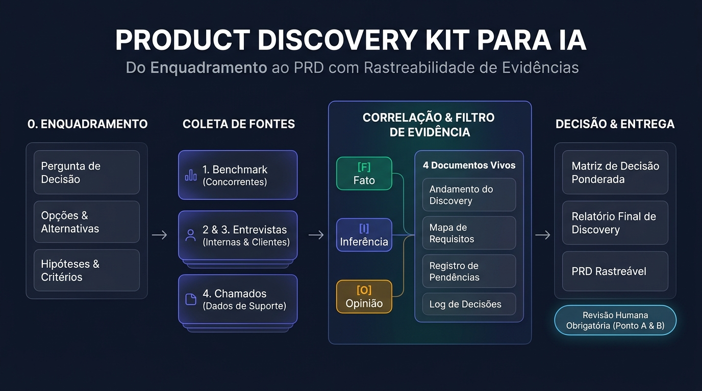

# Product Discovery Kit para IA

Um kit aberto de **8 skills + regras de governança** para transformar sua IA (Claude, Antigravity, Cursor, Claude Code, etc.) em um assistente estruturado de **Product Discovery** — do Enquadramento (Etapa 0) até o PRD final.



---

## 💡 Por que este kit existe?

Quem atua como **Product Owner** ou **Product Manager** sabe que uma das partes mais difíceis de um discovery não é apenas coletar informações, mas **organizar e correlacionar dados que ficam espalhados em vários lugares diferentes** (transcrições de reuniões, planilhas de chamados do suporte, tabelas de benchmark, notas soltas).

Quando jogamos tudo isso numa IA comum sem estrutura, dois problemas acontecem:
1. Ela perde o fio da meada de uma conversa para outra e não cruza o que o cliente falou na entrevista com o que apareceu nos chamados do suporte.
2. Ela mistura **fato** com **opinião** ou **inferência**, tratando um comentário isolado ou uma dedução própria como verdade absoluta.

### O que este kit resolve:
- **Correlação contínua em Documentos Vivos:** Cada dado novo (entrevista, planilha de chamados, rodada de benchmark) atualiza em cascata o **Andamento**, o **Mapa de Requisitos**, o **Registro de Pendências** e o **Log de Decisões**.
- **Separação explícita entre `[F]`, `[I]` e `[O]`:**
  - `[F]` **Fato:** Dito pela fonte ou dado publicado, com referência e data.
  - `[I]` **Inferência:** Leitura ou dedução feita pela IA a partir dos fatos.
  - `[O]` **Opinião:** Ponto de vista de um entrevistado ou sugestão da IA.
- **Você no comando (Pontos de Aprovação A e B):** A IA apresenta o plano antes de rodar uma etapa nova (**Ponto A**) e entrega tudo como `Rascunho` até você revisar e aprovar (**Ponto B**). Nenhuma etapa "conclui sozinha".

---

## 🧩 As 8 Skills do Kit

```text
0. Enquadramento ──► pergunta de decisão, opções, hipóteses, critérios
        │
        ├─► 1. Benchmark (rodadas)             ┐
        ├─► Roteiros ─► 2. Entrevistas internas │  cada dado novo ─► cascata:
        │            └► 3. Clientes e espec.    │  andamento, mapa de requisitos,
        ├─► 4. Chamados de suporte             │  pendências, log de decisões
        └─► Pedidos de dados internos          ┘
                        │
                        ▼
        Mescla para decisão (matriz) ─► Relatório do discovery ─► PRD
```

| Skill | Etapa | O que faz |
|---|---|---|
| **`discovery-abrir`** | Etapa 0: Enquadramento | Define pergunta de decisão, opções, hipóteses e critérios, e monta a pasta com os documentos vivos. |
| **`discovery-benchmark`** | Etapa 1: Benchmark | Planeja e executa rodadas comparativas de concorrentes usando apenas fontes públicas verificáveis. |
| **`discovery-roteiros`** | Preparação de Entrevistas | Cria roteiros ligados às hipóteses para áreas internas (Engenharia, Suporte, CS, Comercial...), clientes e especialistas. |
| **`discovery-entrevista`** | Etapas 2 e 3: Entrevistas | Consolida transcrições/notas separando `[F]` Fato, `[I]` Inferência e `[O]` Opinião, testando hipóteses e cruzando fontes. |
| **`discovery-chamados`** | Etapa 4: Chamados | Consolida exportações de helpdesk/suporte (inclui script Python para cálculo de volume, SLA e mediana de resolução). |
| **`discovery-atualizar`** | Documentos Vivos | Mantém andamento, mapa de requisitos, pendências e decisões sincronizados a cada novo insumo e responde *"Onde estamos?"*. |
| **`discovery-decisao-relatorio`** | Decisão e Relatório | Monta a matriz ponderada de decisão, análise de sensibilidade e redige relatórios parciais ou o relatório final. |
| **`discovery-prd`** | Entrega: PRD | Escreve o PRD com escopo (MVP, incrementos, fora de escopo), métricas e riscos — cada requisito rastreável até as evidências. |

---

## 📦 Como Instalar e Usar

Você pode usar este kit de duas formas:

### Opção 1: No Claude (Web ou Desktop)
1. Baixe a pasta [`skills-para-upload/`](./skills-para-upload) (ou o pacote completo [`kit-discovery-de-produto.zip`](./kit-discovery-de-produto.zip)).
2. No Claude, acesse **Personalizar > Skills** (*Customize > Skills*) e envie os 8 arquivos `.zip` que estão dentro de `skills-para-upload/`.
3. Crie um **Projeto** novo no Claude, abra o arquivo [`docs/1-instrucoes-do-projeto.md`](./docs/1-instrucoes-do-projeto.md), preencha seus dados nos campos `{{ }}` e cole nas **Instruções do Projeto**.

### Opção 2: Em IDEs e Agentes Locais (Antigravity, Claude Code, Cursor)
1. Clone este repositório:
   ```bash
   git clone https://github.com/pereiraevangelista2-sudo/product-discovery-kit.git
   ```
2. O repositório já vem configurado com:
   - [`.agent/skills/`](./.agent/skills) e [`skills/`](./skills): As 8 skills descompactadas com seus templates (`assets/`), referências (`references/`) e scripts (`scripts/`).
   - [`GEMINI.md`](./GEMINI.md), [`CLAUDE.md`](./CLAUDE.md) e [`AGENTS.md`](./AGENTS.md): Regras permanentes carregadas automaticamente pelo agente.
3. (Opcional) Para usar o script de análise quantitativa de chamados em planilhas `.xlsx`/`.csv`, instale as dependências Python:
   ```bash
   pip install -r requirements.txt
   ```

---

## 💬 Exemplos de Comandos no Dia a Dia

| O que você quer fazer | Como pedir para a IA |
|---|---|
| **Começar um discovery** | *"Quero abrir o discovery de `<tema ou produto>`."* |
| **Rodar benchmark** | *"Abra a rodada 1 do benchmark com os concorrentes A, B e C."* |
| **Preparar entrevista** | *"Prepare o roteiro da entrevista com a Engenharia amanhã, 40 minutos."* |
| **Consolidar entrevista** | *"Segue a transcrição da entrevista com `<perfil/área>`."* (anexe ou cole) |
| **Analisar suporte** | *"Segue a exportação de chamados do suporte."* (anexe a planilha) |
| **Registrar decisão** | *"Decidi que o produto será vendido como módulo adicional."* |
| **Checar status** | *"Onde estamos? O que falta validar nas hipóteses?"* |
| **Tomar decisão** | *"Monte a matriz de decisão ponderada."* |
| **Fechar relatório** | *"Faça o relatório final do discovery."* |
| **Escrever o PRD** | *"Escreva o PRD a partir do mapa de requisitos."* |

---

## 📂 Estrutura do Repositório

```text
product-discovery-kit/
├── skills/                         # As 8 skills abertas (templates, referências e scripts)
├── skills-para-upload/             # As 8 skills em .zip prontas para upload no Claude
├── .agent/skills/                  # Configuração automática para agentes locais (Antigravity/Cursor)
├── docs/
│   ├── 1-instrucoes-do-projeto.md  # Template de instruções para colar no seu Projeto
│   ├── 2-guia-da-arquitetura.md    # Explicação completa do método e das 4 camadas
│   └── LEIA-ME.md                  # Guia rápido de instalação original
├── Discoverys/                     # Pasta base onde os discoverys locais são criados
├── GEMINI.md / CLAUDE.md / AGENTS.md # Regras de governança para agentes de IA
├── kit-discovery-de-produto.zip    # Pacote completo em arquivo único para download direto
└── requirements.txt                # Dependências para o script de análise de chamados
```

---

## 🤝 Contribuições e Feedback

Sentiu falta de alguma etapa ou adaptou o kit para o contexto do seu time de produto? Fique à vontade para abrir uma *issue*, mandar um *pull request* ou compartilhar como tem usado!
